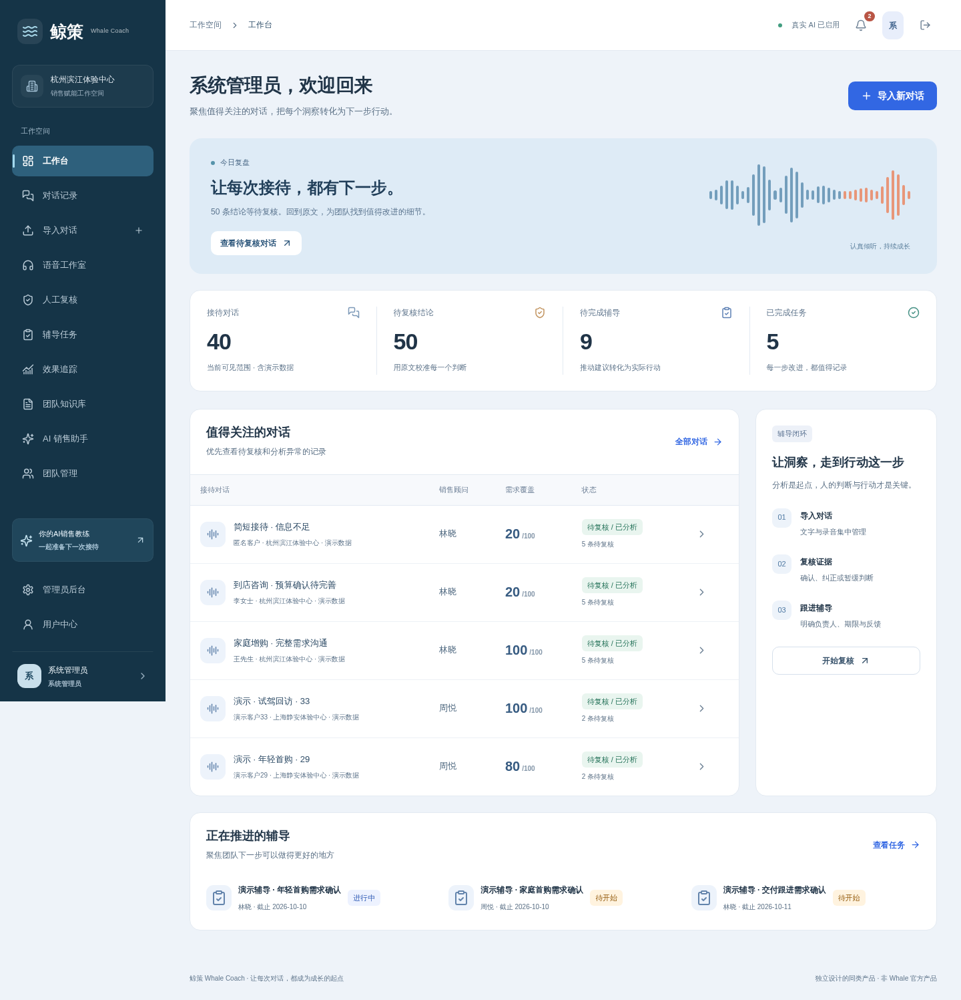
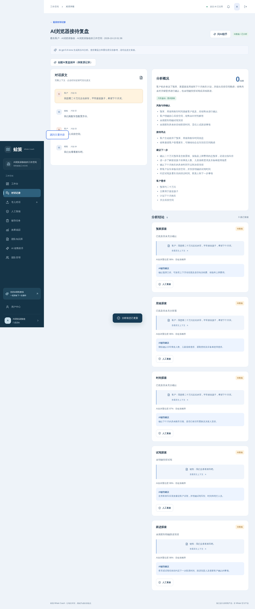
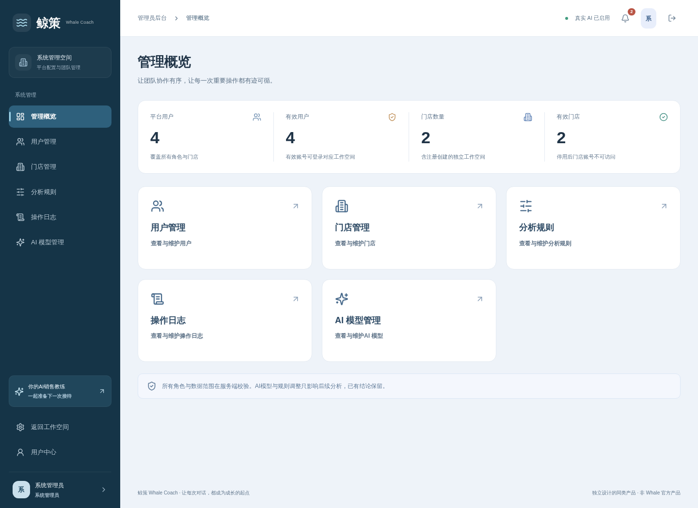

# 鲸策 Whale Coach

鲸策是一套面向销售团队、门店经理和培训管理者的 AI 销售复盘与辅导平台，将接待对话导入、录音转写、证据定位、AI 分析、人工复核、辅导任务和周期报表连接成完整工作流。

## 核心能力

- 文本与录音接待统一导入、转写和证据定位。
- AI 接待分析、销售助手、辅导建议和报表解读。
- 人工复核、任务反馈、知识库和站内通知。
- 门店隔离、角色权限、审计日志和周期统计。
- CSV 导出、语音工作室和运营后台。

## 产品界面

## 技术架构

- React、Next.js 16、Node.js 22
- MySQL 5.7/8.0
- FFmpeg/FFprobe、Nginx、systemd

## 本地运行

1. 安装 Node.js 22、MySQL 和 FFmpeg。
2. 执行 `npm ci`。
3. 复制 `.env.example` 为 `.env` 并填写数据库、会话与 AI 配置。
4. 依次执行数据库初始化和所需迁移脚本。
5. 执行 `npm run build`，然后运行 `npm start`。

默认服务端口为 `3030`，录音与麦克风能力需要可信 HTTPS 环境。

## 生产部署

使用专用非登录用户运行 `whale-coach.service`，Nginx 反向代理到应用端口。更新前备份 MySQL、`.env`、录音存储和知识库文件；先完成构建及回归测试，再重启服务。完整测试运行 `npm test`，界面验证运行 `npm run test:ui`。

## 项目结构

- `src/app/`：页面与 API
- `src/lib/`：业务、数据库、AI 和证据校验
- `database/`：数据库结构
- `storage/`：受保护的录音文件
- `scripts/`：初始化、迁移、测试和备份
- `docs/`：产品与技术文档
- `project-docs/`：项目维护记录

## 联系方式

微信：`charlesyin6015`
