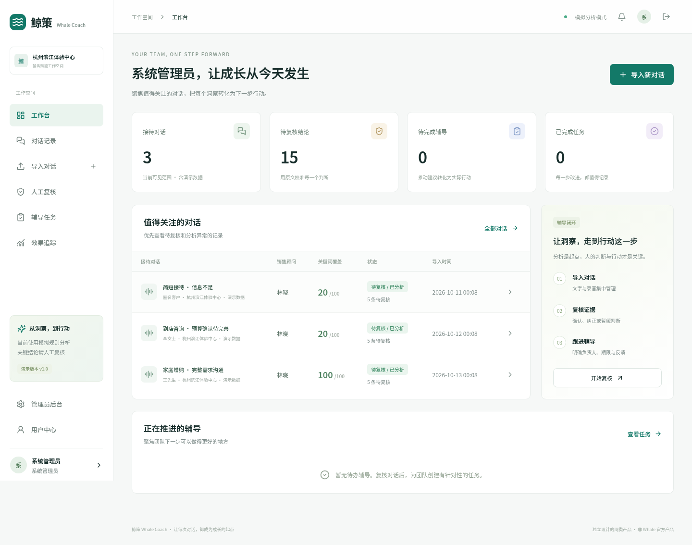
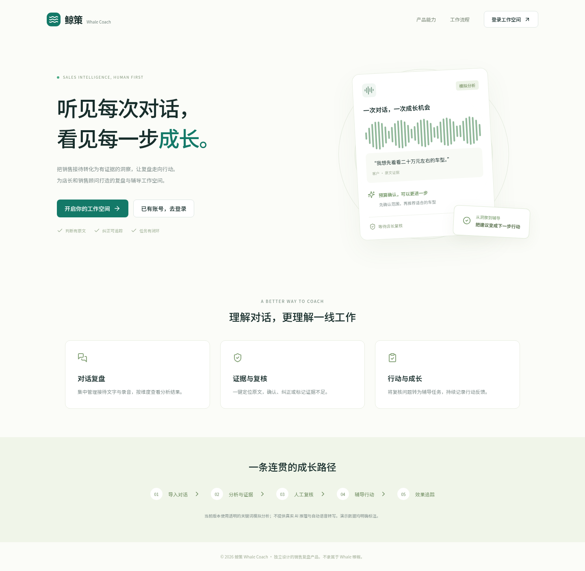
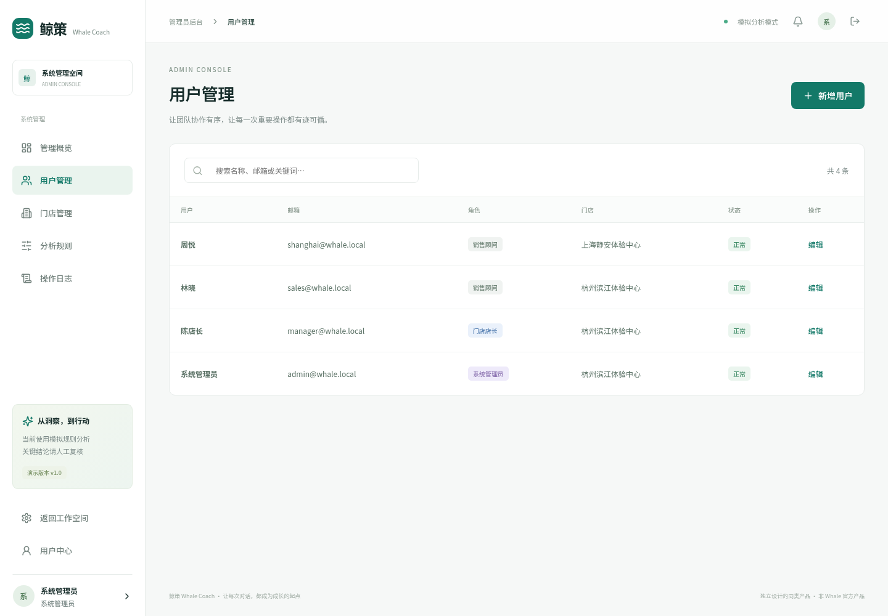

# 鲸策 Whale Coach · AI 教练与知识协作平台

鲸策是一套面向教练、咨询顾问和知识型团队的 AI 工作平台，将客户档案、对话、知识库、行动计划、团队协作、语音能力和运营管理整合到统一系统中。

## 主要功能

- 客户档案、目标、会话记录、复盘和行动计划。
- AI 对话、知识检索、内容生成和多模型配置。
- 团队协作、共享查询、任务和服务流程。
- 语音输入、助手语音和移动端交互。
- 用户、内容、模型、调用日志和运营后台。
- 权限隔离、敏感配置加密、审计与数据库备份。

## 产品界面







## 技术架构

- Next.js 16、React 19、Node.js 22。
- MySQL、服务端会话与 AI 供应商兼容接口。
- Playwright 自动化测试，Nginx 与 systemd/PM2 部署。

## 环境要求

- Node.js 22+、npm 10+、MySQL 8.0。
- 可访问的兼容 AI 服务；语音功能需要相应服务和 HTTPS。

## 本地安装

```bash
git clone https://github.com/CharlesYin1204/whale-coach.git
cd whale-coach
npm ci
cp .env.example .env
npm run db:init
npm run db:knowledge
npm run db:collaboration
npm run dev
```

访问 `http://localhost:3030`。已有数据库应先备份，再按版本执行迁移，避免重复初始化。

## 环境变量

| 配置 | 说明 |
| --- | --- |
| `DB_HOST`、`DB_PORT`、`DB_USER`、`DB_PASSWORD`、`DB_NAME` | MySQL 连接 |
| `APP_ORIGIN`、`APP_ORIGINS` | 允许的站点来源 |
| `AI_ENCRYPTION_KEY` | AI 密钥加密密钥 |
| `AI_ALLOWED_HOSTS` | 允许访问的 AI 服务域名 |

模型地址和 API 密钥通过初始化或后台配置，不应写入 Git。

## 构建与测试

```bash
npm run build
npm run test:core
npm run test:knowledge
npm run test:collaboration
npm run test:admin
npm run test:ui
```

完整测试可执行 `npm test`；涉及真实供应商的测试可能产生费用，应使用隔离配置。

## 生产部署

1. 安装 Node.js 22、MySQL、Nginx，创建独立数据库用户和系统用户。
2. 拉取代码、执行 `npm ci`，创建权限为 `600` 的 `.env`。
3. 初始化新库或对已有库按顺序执行迁移，并先完成备份。
4. 配置 AI 允许域名、加密密钥和站点来源。
5. 执行 `npm run build` 和必要回归测试。
6. 使用 systemd/PM2 运行 `npm start`，监听 `3030`。
7. Nginx 反向代理到 `127.0.0.1:3030` 并启用 HTTPS。
8. 配置数据库备份、日志轮转、健康检查和 AI 用量监控。

更新时先备份数据库，再执行依赖安装、迁移、构建和滚动重启；失败时停止发布并回滚。

## 项目结构

- `app/`：页面和 API。
- `components/`：产品界面组件。
- `lib/`：数据库、鉴权、AI 和业务服务。
- `scripts/`：迁移、初始化、测试和备份。
- `database/`：数据库结构。
- `docs/screenshots/`：产品截图。

## 常见问题

- AI 连接失败：检查域名白名单、网络、密钥和模型标识。
- 登录后被拒绝：检查 `APP_ORIGIN` 与反向代理协议头。
- 语音不可用：确认 HTTPS、浏览器权限和语音服务进程。
- 迁移失败：停止服务，检查数据库版本并从备份恢复后重试。

## 联系方式

微信：`charlesyin6015`
